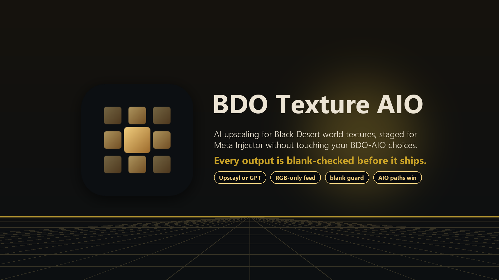

<div align="center">



[](https://github.com/SenjuWoo/BDO-TEX-AIO/actions/workflows/ci.yml)
[](https://github.com/SenjuWoo/BDO-TEX-AIO/releases/latest)
[](#requirements)
[](START.bat)
[](LICENSE)

**[Quick start](#quick-start)** · **[Menu](#menu)** · **[Blank-output trap](#blank-output-trap)** · **[How it works](#how-it-works)** · **[Safety](#safety-summary)** · **[Changelog](CHANGELOG.md)**

</div>

BDO Texture AIO upscales **Black Desert Online world textures** (landscape, buildings,
props, NPCs and optional mounts) with Upscayl or your own GPT / SwarmUI / ComfyUI pass,
then packs them back to DDS with full mips and stages them for Meta Injector. It is the
companion to [BDO-AIO](https://github.com/SenjuWoo/BDO-AIO): BDO-AIO owns your body,
pube, genital and outfit **choices**, and this tool never overrides them. An opt-in
bodies mode gives the bodies you already picked higher-resolution pixels, and an opt-in
player/GPT mode handles playable-class `p*` textures.

## What you get

- **World textures by default.** Landscape, buildings, props, trees and terrain detail; NPC/monster skins and playable-class textures only when you switch them on.
- **Your BDO-AIO choices always win.** Stage skips any path BDO-AIO (or the bodies layer) already put in `files_to_patch`, and nothing is ever written into the BDO-AIO folder.
- **No invisible textures.** Upscayl can silently write an all-black image and still exit 0. Every output is blank-checked, failures are retried one at a time, and anything still blank is refused before packing.
- **Alpha handled properly.** The upscaler sees RGB only; the cutout alpha is split off and re-attached with Lanczos, so the AI never invents soft edges on a mask.
- **Only real companion maps.** Existing `_n` / `_sp` / `_m` / … maps are resized to match; new ones are never invented (Meta Injector rejects paths that are not in `pad00000.meta`).
- **Your own upscaler if you want.** `[A]` exports PNGs plus `gpt-export.zip`; `[B]` packs the returned zip (zip-slip guarded) or folder.
- **Resumable stages.** Scan, extract, upscale, companions, pack and stage each write their own manifest under `work\`.


The UI is the `START.bat` / `bdo_tex.ps1` console menu; the image above is the bundled
self-test (menu `[V]`), which needs no game install.

## Quick start

1. Install Python 3, then `pip install pillow numpy`, and [Upscayl](https://upscayl.org/) (its CLI lives inside the install).
2. Double-click **`START.bat`**. The first run copies `config.example.json` to `config.json`; set `gameDir` to your Black Desert install (and `bdoAioRoot` to your BDO-AIO folder if you use bodies mode).
3. Pick a preset with `[P]`, then `[7]` for the whole pipeline, or run the steps one by one.

From a shell:

```bat
pip install pillow numpy
python tools\bdo_tex.py status
python tools\bdo_tex.py scan
python tools\body_mats.py status
```

Recommended run order with the other tools:

```text
1. BDO-AIO          pick + DEPLOY bodies/pubes/outfits
2. BDO-TEX-AIO      this app: [Y] bodies (optional), then world textures
3. PartCutGen       if you use it
4. Meta Injector    once on the game Paz folder
```

TEX can be processed anytime (scan/upscale are self-contained under `work\`), but
**stage after AIO deploy** so collision checks see AIO paths and skip them.
[`WORKFLOW.txt`](WORKFLOW.txt) has the same order in plain text.

## Relationship to BDO-AIO (choices always win)

| App | Owns |
| --- | --- |
| **BDO-AIO** | Body / pube / genital / outfit **choices** |
| **BDO-TEX-AIO** (this) | World / environment; optional NPC skins; optional higher-res of the **same** chosen bodies |

This tool:

- **Never** includes playable-class `character/texture/p*` assets unless you opt in (`[G]` / `includePlayerTextures`, for a GPT/texconv pass)
- **By default** skips LODs / SpeedTree **billboards** / impostors (optional high toggle `[L]` / `includeLodBillboards`)
- **Never** overwrites a path already present in `files_to_patch` (AIO, bodies, …)
- **Never** writes into the BDO-AIO install folder
- Writes only `files_to_patch\_bdo_tex_upscale\` (world) and `files_to_patch\_bdo_aio_bodymats\` (bodies mode)

So after you pick bodies in BDO-AIO, TEX will not stomp those choices. Paths AIO (or the
bodies layer) already staged are **skipped** at stage time, even in player mode.

## Menu

| Key | Action |
| --- | --- |
| `1`–`6` | Scan → extract → upscale → companions → pack → stage |
| `7` | Full pipeline |
| `A` | Export PNGs + `gpt-export.zip` for GPT / Codex / SwarmUI / ComfyUI |
| `B` | Pack from returned GPT zip (prompts for path; Enter = swarm folder) |
| `C` | Toggle character/texture (NPC/monster; not player classes) |
| `G` | Toggle player/GPT textures (playable `p*`; opt-in) |
| `X` | Toggle bodies (enhance BDO-AIO choices; **OFF** default) |
| `Y` | Run bodies pipeline: scan → process → stage (after AIO deploy) |
| `L` | Toggle LOD/billboards (**OFF** default; high option, low ROI) |
| `N` | Toggle companion-map matching |
| `P` / `T` / `M` | Preset / target / model |
| `S` | Status |
| `V` | Run the self-tests |
| `R` | Remove `_bdo_tex_upscale` only |
| `Q` | Quit |

Presets (`[P]`, from `presets.json`): **Playtest** (1024, recommended first), **Quality**
(2048), **Balanced** (1024, softer), **Long edge 1440**, **Max sharp** (experimental) and
**Fast** (lite model).

## Commands

The menu drives `tools\bdo_tex.py`; every stage is also a subcommand:

| Command | Does |
| --- | --- |
| `scan` | Build the candidate list from `pad00000.meta` with real pixel dimensions |
| `extract` | PAZ → PNG (mip 0, lossless) |
| `upscale` | Upscayl pass, then exact-size resample with the blank check |
| `materials` | Resize **existing** companion maps to match the upscaled albedo |
| `swarm-export [--zip]` / `gpt [--zip]` | Hand PNGs to GPT / SwarmUI / ComfyUI |
| `pack [--source gpt\|swarm] [--zip <file>]` | PNG → DDS with full mip chain |
| `stage` / `unstage` | Copy into `files_to_patch\_bdo_tex_upscale`, or remove only that folder |
| `preset` / `status` | List or apply a preset; show the active settings |

`tools\body_mats.py` has the same shape for bodies mode (`scan`, `process`, `stage`, `status`).

## How it works

```text
pad00000.meta -> scan -> extract -> upscale -> companions(match) -> pack -> stage
```

| Step | What |
| --- | --- |
| Scan | Eligible colour textures under configured roots |
| Extract | PAZ → PNG (mip 0) |
| Upscale | Upscayl on **RGB only**, alpha re-attached after; every output blank-checked. Or **GPT mode**: export → your own GPT batch → `pack --source gpt` |
| Companions | Resize **existing** `_n`/`_sp`/… that already exist in the archive |
| Pack | DDS + full mips |
| Stage | Only unclaimed world paths → `_bdo_tex_upscale` |

**Companions:** only maps already in `pad00000.meta` for that albedo. Inventing new `_n`
fails Meta Injector (not in meta). No ParallaxGen equivalent for BDO.

The game directory is only ever opened for reading; the single write target is
`files_to_patch`, Meta Injector's own staging folder.

### GPT / player-texture mode (opt-in)

World textures are the default. Playable-class `character/texture/p*` is BDO-AIO
territory, so this tool stays out unless you say otherwise. Press `[G]` (or set
`includePlayerTextures: true` in config) to opt them back in for a GPT / external
upscaler pass:

```text
[G] player mode on  ->  [1] scan  ->  [2] extract  ->  [A] export -> work\04_swarm_in + gpt-export.zip
     -> send work\gpt-export.zip to GPT / Codex (prompt: "upscale/enhance each PNG,
        keep filenames AND folder structure, return a zip")
     -> drop the returned zip anywhere, [B] prompts for its path
     -> [6] stage  ->  Meta Injector
```

- Zip round-trip: `[A]` also writes `work\gpt-export.zip`; `[B]` accepts the returned zip (`pack --source gpt --zip <file>`, zip-slip guarded) or Enter to keep the old folder flow (`work\05_swarm_out`).
- `texconv.exe` ships in `tools\`. Pack uses the bundled `dds.py`; texconv is there as an alternative for companion-map encoding if you configure it.
- Stage still skips any path BDO-AIO / BodyMats already claimed. AIO wins.
- Every GPT result is blank-checked before packing; all-black outputs are skipped, never shipped (same guard that caught Upscayl's silent blanks).
- Output format follows each texture's own header (DXT1/DXT5, full mips), so there is no manual format matching; the GPT PNG just needs to be ≥ the source size.
- Same folder flow works with SwarmUI / ComfyUI (`swarm-export`, `--source swarm`).

### Bodies mode (opt-in, replaces BDO-AIO-BodyMats)

BDO-AIO owns which bodies/pubes/outfits you use. **Bodies mode** only upscales the winner
files AIO already staged into `files_to_patch` (layer priority: `_pubic_hair_` >
`_genital_` > `_midnight_`), and resizes existing companion maps (`_n`/`_sp`/`_m`/…). It
never invents maps and never writes into AIO's folders; the stage target is
`files_to_patch\_bdo_aio_bodymats\`.

```text
[X] bodies on  ->  BDO-AIO must already be DEPLOYED
[Y] scan -> process -> stage   (writes _bdo_aio_bodymats only)
```

- Nude skin albedos upscale toward **4096**; other albedos toward **2048**.
- Only **existing** companion maps are resized, never invented (Meta Injector rejects paths not in `pad00000.meta`).
- Same safety rails as the world path: RGB-only upscale with alpha re-attached, blank-output check with LANCZOS fallback, DDS via bundled `dds.py` (no texconv needed).
- The old **BDO-AIO-BodyMats** app is merged into this tool (v1.5.0); run `python tools\body_mats.py status` for the same read-only view.

## Blank-output trap

Measured on the author's machine (RTX 4080 SUPER, 9800X3D), 150 real BDO textures per
config, **every output checked for blankness**:

| Config | 5,187 textures | Output |
| --- | ---: | --- |
| `tile=400` (old default) | ~81 min | valid |
| `tile=auto` | **~54 min** | valid |
| `tile=1024` / `tile=2048` | ~10 min | **blank, all of it** |
| `upscayl-lite`, RGBA input | ~7 min | **blank (146/150)** |
| `upscayl-lite`, RGB input | **~21 min** | valid |

> **upscayl-bin can write a completely empty image, print `🙌 Upscayled Successfully!`, and exit 0.** Nothing in the exit code or the log tells you. Two triggers were reproduced: a large `-t`, and an RGBA input under load. Configs that looked 7× faster were fast because they were producing nothing.

So the pipeline now:

1. **Feeds RGB only.** Alpha is split off before the upscaler and re-attached with Lanczos afterwards. This removes the RGBA trigger *and* is the correct treatment anyway: alpha in these textures is a cutout mask, and an AI model invents soft edges on it.
2. **Blank-checks every output** during the resample pass (free, as it is already decoding), retries the failures one at a time at `1:1:1`, and **refuses to write** anything still blank so `pack`/`stage` cannot ship invisible textures.

| Key | Default | Meaning |
| --- | ---: | --- |
| `upscaleBatch` | 256 | PNGs per Upscayl process. **Resume granularity, not a VRAM knob**: VRAM is set by tile and threads, so small batches only pay ~3s of process start-up each |
| `upscaylGpu` | `"0"` | GPU id (`-g`); empty = auto |
| `upscaylTile` | `0` | Tile size (`-t`); `0` = auto. **Do not raise this**: 1024/2048 produce blank images |
| `upscaylThreads` | `"2:4:2"` | load:proc:save (`-j`). Drop to `1:1:1` if blanks appear |

Upscayl uses **Vulkan/ncnn**, not CUDA. If a batch crashes outright (ACCESS_VIOLATION) it
retries one file at a time; resume keeps finished raws.

**If it is still too slow:** preset `[P]` → *Fast (lite model)* uses `upscayl-lite-4x`
(~21 min instead of ~54) with visibly softer detail. Model choice barely matters
otherwise: when output is actually valid, every model lands in the 1.4–2.2 img/s band on
that GPU.

## Defaults

- **Roots:** world only (`object/texture`, trees, terrain detail)
- **Character textures:** OFF (menu `[C]` to enable NPC/monster; player `p*` opt-in via `[G]`)
- **Target:** use menu `[P]` presets (playtest 1024, quality 2048, …)

## Requirements

- Windows, Python 3 + Pillow + numpy
- Upscayl (CLI inside the install)
- Meta Injector to apply `files_to_patch`
- Optional: GPT / SwarmUI / ComfyUI for the external-upscaler path

## Config

The first run copies `config.example.json` → `config.json`. Set `gameDir` to your Black
Desert install. Keep `workDir` as `"work"` (stays next to the app). Bodies mode keys:
`bodiesEnabled` (menu `[X]`), `bdoAioRoot` (your BDO-AIO folder; blank = not set),
`skinAlbedoTarget` (4096), `otherAlbedoTarget` (2048), `allowPackFallback` (false),
`stageLayerName` (`_bdo_aio_bodymats`), `bodyWorkDir` (`work_body`).

## Safety summary

| Rule | Enforced how |
| --- | --- |
| No player-class textures unless `[G]` opt-in | `texfilter` playable-class block + `includePlayerTextures` |
| AIO paths not overwritten | Stage skips any path owned by another layer |
| Never stage inside BDO-AIO | `body_mats` refuses a stage target under `bdoAioRoot` |
| No invent materials | Companions = archive siblings only |
| Isolated work | All caches under app `work\` |
| Blank Upscayl/GPT output never ships | RGB-only feed + per-image blank check |

## Honest status

Verified in this tree:

- CI (`.github/workflows/ci.yml`): PowerShell parse + PSScriptAnalyzer, JSON, Python compile, and both self-test scripts
- self-tests in `tools/test_bdo_tex.py` (17 checks: filter rules, collision guard, refusal to write into the game dir, blank detection, pack skip) and `tools/test_body_mats.py` (6 checks), plus the DDS writer self-check
- blank-output timings above are from the author's RTX 4080 SUPER / 9800X3D measurements, not a claim about every GPU

Not claimed:

- a GUI (console menu only)
- that GPT/Codex upscale quality is verified beyond the blank-check
- that every world texture in a live PAZ has been upscaled in CI

## License

[MIT](LICENSE)
